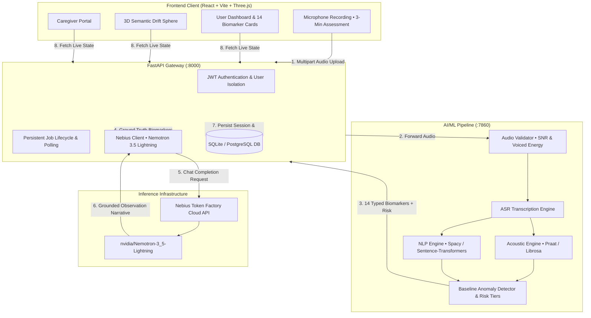

# CogniSafe 🧠
### *Voice-First Longitudinal Cognitive-Health Monitoring Platform*

[](https://github.com/Aryaman129/Cogni)
[](https://build.nvidia.com)
[](https://nebius.com)
[](https://fastapi.tiangolo.com)
[](https://react.dev)
[](https://threejs.org)
[](LICENSE)

---

## 📌 Overview

**CogniSafe** is an AI-powered, voice-first cognitive-health monitoring platform. By conducting brief, standardized speech assessments (such as picture descriptions), CogniSafe analyzes **14 clinically grounded speech and language biomarkers** and tracks changes over time against the user's **personal historical baseline**.

Rather than relying on one-off population averages or static tests, CogniSafe observes subtle longitudinal trajectory shifts in acoustic motor-speech patterns and linguistic cohesion. It pairs mathematical anomaly detection with **NVIDIA Nemotron 3.5 Lightning** via **Nebius Token Factory** to deliver clear, clinician-oriented explanations with strict anti-hallucination guardrails.

> **Medical Disclaimer:** CogniSafe is an exploratory, longitudinal monitoring tool designed to assist individuals and caregivers. It does not provide medical diagnoses or replace clinical neuropsychological evaluations.

---

## 🌟 Key Capabilities & Differentiators

### 1. The 14 Canonical Biomarker Engine
CogniSafe extracts and verifies 14 speech biomarkers across two complementary domains, ensuring every metric has mathematical integrity, audio validation, and typed failure handling:

#### 🎙️ Acoustic Biomarkers (10)
| Biomarker | Unit | Clinical Rationale & Extraction Methodology |
| :--- | :--- | :--- |
| **`speech_rate`** | `wpm` | Total words spoken per minute over total recording duration. Detects cognitive planning latency. |
| **`articulation_rate`** | `syllables/sec` | Pacing computed strictly over voiced phonation frames, isolating articulation speed from hesitation pauses. |
| **`pause_frequency`** | `pauses/min` | Frequency of silent pauses ($\ge 250$ ms) per minute. Reflects word-finding latency. |
| **`pause_duration_mean`** | `seconds` | Average length of silence intervals. Prolonged pauses correlate with lexical retrieval deficits. |
| **`filled_pause_rate`** | `fillers/min` | Frequency of hesitation vocalizations (*"um"*, *"uh"*, *"er"*). Highlights lexical search effort. |
| **`pitch_mean`** | `Hz` | Mean fundamental frequency ($F_0$) during voiced frames, providing acoustic baseline phonation. |
| **`pitch_range`** | `Hz` | Prosodic pitch modulation computed between 95th and 5th percentiles of voiced $F_0$. Detects monopitch. |
| **`jitter`** | `%` | Period-to-period micro-perturbation in fundamental frequency. Measures vocal cord stability. |
| **`shimmer`** | `%` | Cycle-to-cycle amplitude variability across voiced speech. Quantifies phonatory instability. |
| **`HNR`** | `dB` | Harmonics-to-Noise Ratio. Reflects breathiness and dysphonia in sustained vowel segments. |

#### 📖 Linguistic & NLP Biomarkers (4)
| Biomarker | Unit | Clinical Rationale & Extraction Methodology |
| :--- | :--- | :--- |
| **`lexical_diversity`** | `MTLD` | Measure of Textual Lexical Diversity (MTLD), mathematically invariant to transcript length. |
| **`semantic_coherence`** | `0.0 - 1.0` | Cosine similarity across sentence embedding trajectories. Measures topic cohesion and thematic drift. |
| **`idea_density`** | `ratio` | Ratio of semantic propositions (verbs, adjectives, prepositions) per total words. Measures information density. |
| **`syntactic_complexity`**| `depth` | Mean dependency parse tree depth, quantifying grammatical structure and sentence elaboration. |

---

### 2. NVIDIA Nemotron 3.5 Lightning via Nebius Token Factory
CogniSafe integrates NVIDIA's cutting-edge **Nemotron 3.5 Lightning** model hosted on **Nebius Token Factory** (`https://api.tokenfactory.eu-north1.nebius.com/v1/`).

- **Strict Anti-Hallucination Guardrails:** The LLM is explicitly prevented from inventing or recalculating numerical measurements, units, or risk tiers.
- **Ground-Truth Anchor Verification:** Observations must cite registered biomarker keys. All values and units displayed in the UI are populated authoritatively by the backend from verified sensor extractions.
- **Resilient Fallback:** Automatically detects offline or unreachable states and transitions seamlessly to deterministic clinical rule-based templates.

---

### 3. Personal Baseline & Anomaly Detection
CogniSafe rejects rigid population averages in favor of an individualized baseline model:
- **Baseline Maturity Gate:** Requires a minimum of **5 valid sessions** before establishing personal baseline statistics ($Mean$ and Standard Deviation $\sigma$).
- **Dynamic Reference Bands:** Plots historical reference bands ($Mean \pm 1.96\sigma$) for each biomarker.
- **Decoupled Risk Semantics:** Separates operational status (`insufficient_baseline`, `insufficient_data`, `complete`) from clinical risk tiers (`Green`, `Yellow`, `Orange`, `Red`), preventing false alarms.

---

### 4. Interactive 3D Semantic Drift Sphere
Built with **Three.js**, the interactive semantic drift sphere renders spoken concepts in 3D vector space:
- Demonstrates vocabulary clustering, topic stability, and semantic shift between sessions.
- Allows intuitive user and clinician exploration of associative thought pathways.

---

### 5. Secure Caregiver Family Portal
- Cryptographically secure, scoped, and revocable caregiver share tokens.
- Caregivers receive plain-language summaries and longitudinal trends without granting full account access.

---

## 🏗️ Architecture & Data Flow



---

## ⚡ Quickstart & Setup Guide

### Prerequisites
- **Python 3.11+** or **3.12+**
- **Node.js 18+** and **npm**
- **Git**
- *(Optional)* Nebius Token Factory API Key (offline fallback works automatically without it)

---

### 1. Clone the Repository
```bash
git clone https://github.com/Aryaman129/Cogni.git
cd Cogni
```

---

### 2. Environment Configuration
Create a `.env` file in the root and in `cognisafe-backend/` (template available in `.env.example`):

```ini
# Security & JWT
SECRET_KEY=your_secure_random_64_character_hex_key_here
ALGORITHM=HS256
ACCESS_TOKEN_EXPIRE_MINUTES=1440
ENVIRONMENT=development

# Database & CORS
DATABASE_URL=sqlite:///./cognisafe.db
ALLOWED_ORIGINS=http://localhost:5173,http://localhost:3000

# Nebius Token Factory & NVIDIA Nemotron 3.5 Lightning
NEBIUS_API_KEY=your_token_factory_api_key_here
NEBIUS_BASE_URL=https://api.tokenfactory.eu-north1.nebius.com/v1/
NEBIUS_MODEL_ID=nvidia/Nemotron-3_5-Lightning
NEBIUS_TIMEOUT_SECONDS=30.0

# Audio Processing Boundaries
UPLOAD_MAX_SIZE_BYTES=26214400
UPLOAD_DIR=uploads
```

---

### 3. Install Dependencies & Seed Database

#### Backend Setup
```bash
cd cognisafe-backend
pip install -r requirements.txt
python seed.py
cd ..
```
> *`python seed.py` populates a demo account (`demo@cognisafe.app / demo1234`) with 6 months of historical sessions.*

#### ML Pipeline Setup
```bash
cd cognisafe-deploy
pip install -r requirements.txt
cd ..
```

#### Frontend Setup
```bash
cd cognisafe-frontend
npm install
cd ..
```

---

### 4. Running the Platform

#### Option A: One-Click Startup (Windows)
Run the automated launcher:
```bat
start_all.bat
```

#### Option B: Manual Startup (Separate Terminals)
```bash
# Terminal 1: AI/ML Pipeline
cd cognisafe-deploy
python api/main.py

# Terminal 2: FastAPI Backend
cd cognisafe-backend
uvicorn main:app --reload --port 8000

# Terminal 3: React Frontend
cd cognisafe-frontend
npm run dev
```

---

### 5. Accessing Services

| Service | Endpoint | Description |
| :--- | :--- | :--- |
| **Web Application** | [http://localhost:5173](http://localhost:5173) | Interactive patient dashboard, 3D sphere & recording |
| **FastAPI Backend Docs** | [http://localhost:8000/docs](http://localhost:8000/docs) | Interactive OpenAPI Swagger UI |
| **ML Pipeline Docs** | [http://localhost:7860/docs](http://localhost:7860/docs) | Feature extraction & biomarker pipeline API |

#### Demo Login Credentials
- **Email:** `demo@cognisafe.app`
- **Password:** `demo1234`
*(Or click **Register** on the login page to create your own account)*

---

## 🧪 Testing & Verification

CogniSafe includes an end-to-end test suite covering unit math, boundary integrity, and adversarial speech scenarios:

```bash
# Run all unit tests
pytest tests/unit -v

# Run challenger speech tests & E2E scenarios
pytest tests/e2e -v

# Run full test suite with coverage
pytest --cov=cognisafe-backend --cov=cognisafe-deploy
```

**Test Coverage Highlights:**
- ✅ **Mathematical Invariance:** Validates MTLD and pause ratios across varying token lengths.
- ✅ **Audio Signal Boundaries:** Rejects silent audio, clipped recordings, and high-noise environments.
- ✅ **Anti-Hallucination Guardrails:** Verifies that unknown or unmeasured biomarkers from LLM responses are rejected.
- ✅ **JWT & Caregiver Security:** Confirms that unauthenticated requests and expired tokens fail with HTTP 401/403.

---

## 📡 API Reference Overview

### Authentication (`/api/auth`)
- `POST /api/auth/register` — Register a new user account with hashed password.
- `POST /api/auth/login` — Authenticate and receive a JWT Bearer access token.

### Sessions & Analysis (`/api/sessions`)
- `GET /api/sessions/latest` — Fetch the user's latest recorded session and biomarkers.
- `GET /api/sessions/history?months=3` — Retrieve historical biomarker trajectories.
- `POST /api/sessions/` — Record and store a newly computed session.

### AI Explanations & Nemotron (`/api/ai`)
- `POST /api/ai/explain-anomaly` — Generate Nemotron 3.5 Lightning biomarker explanation.
- `POST /api/ai/weekly-summary` — Produce structured longitudinal cognitive summaries.
- `POST /api/ai/caregiver-summary` — Plain-language family briefing.

### Caregiver Sharing (`/api/caregiver`)
- `POST /api/caregiver/share` — Create a secure, scoped access token for family/caregivers.
- `GET /api/caregiver/shared/{token}` — Public view for authorized caregivers.

---

## 👤 Author & Maintainer

**Aryaman Mohta**  
- **GitHub:** [@Aryaman129](https://github.com/Aryaman129)  
- **Repository:** [https://github.com/Aryaman129/Cogni](https://github.com/Aryaman129/Cogni)

---

## 📄 License

This project is licensed under the **MIT License** — see the [LICENSE](LICENSE) file for details.
